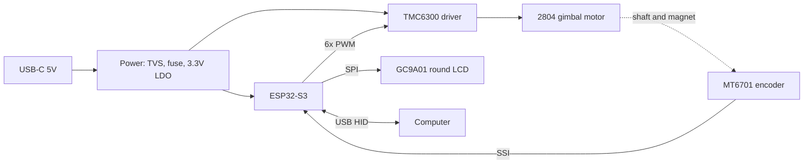

# DETENT

**A motorised haptic dial for video editing.** One knob that can *feel* like many: notched when you step frame by frame, smooth when you scrub, with a hard stop at the end of a clip.

> **Status: design phase.** This repository is being built in public as a Hack Club *Half Life* warm-up submission (Tier 3). Items marked ☐ are not done yet. Nothing here has been fabricated or tested, and no performance numbers in this repo are measured unless stated.

## Concept

A brushless gimbal motor sits behind the knob. A magnetic encoder reads the knob angle, and a field-oriented-control (FOC) loop applies torque in software. By changing the torque as a function of angle and speed, the same hardware can imitate:

| Mode | Feel | Intended use |
|---|---|---|
| Detent | Discrete clicks at fixed angles | Frame stepping |
| Free scrub | Light viscous drag | Timeline scrubbing |
| Bounded | Soft wall at both ends | Clip trim, zoom range |
| Free | Motor off, minimal friction | Fast spin |

A 240x240 round LCD shows the active mode. The device enumerates over USB as a HID device and sends editing shortcuts.

## System overview



Details: [`docs/architecture.md`](docs/architecture.md)

## Repository layout

```
detent/
├── README.md
├── BOM.csv                  Bill of materials with estimated costs
├── LICENSE                  MIT
├── docs/
│   ├── architecture.md      Block design, pin plan, power budget, PCB rules
│   ├── test-plan.md         Bring-up and validation plan
│   └── design-log.md        Dated work log
├── pcb/                     KiCad project and fabrication outputs
├── cad/                     Enclosure and knob (STEP and STL)
├── firmware/                PlatformIO project (haptics logic + unit tests)
└── images/                  Renders and screenshots
```

## Design goals

1. Single custom 4-layer PCB, round, fits behind the display inside the enclosure
2. Powered from USB only, with firmware current limiting
3. Haptic update loop of 1 kHz or faster
4. Enclosure printable on a standard FDM printer without supports where possible
5. Fully open: schematics, layout, CAD and firmware in this repository

## Known risks

- **Torque.** Gimbal motors produce modest torque. Detents may feel subtle. Validating this early is the first bench test.
- **USB power budget.** A default USB 2.0 port gives 500 mA. Motor current must be capped in firmware.
- **Encoder alignment.** The magnet and sensor must be coaxial and at the right gap, or angle error will degrade the haptic feel.
- **4-layer routing.** Motor switching noise near the encoder and display lines needs careful layout.

## Progress

- [x] Concept and component selection
- [x] Architecture document
- [x] Firmware haptics module and unit tests (host-side, not yet run on hardware)
- [ ] Schematic (KiCad)
- [ ] PCB layout and design rule check
- [ ] Enclosure CAD
- [ ] Parts ordered
- [ ] Board assembled
- [ ] Firmware bring-up on hardware
- [ ] Demo video

## Building the firmware

Requires [PlatformIO](https://platformio.org/).

```bash
cd firmware
pio test -e native        # run host-side unit tests
pio run -e esp32s3        # compile for the board (hardware layer still stubbed)
```

## License

MIT. See [`LICENSE`](LICENSE).

## Acknowledgements

Built for Hack Club Half Life. Haptic-knob concepts are well explored in the open-source community, notably the SimpleFOC project, which this design draws on for motor control.
